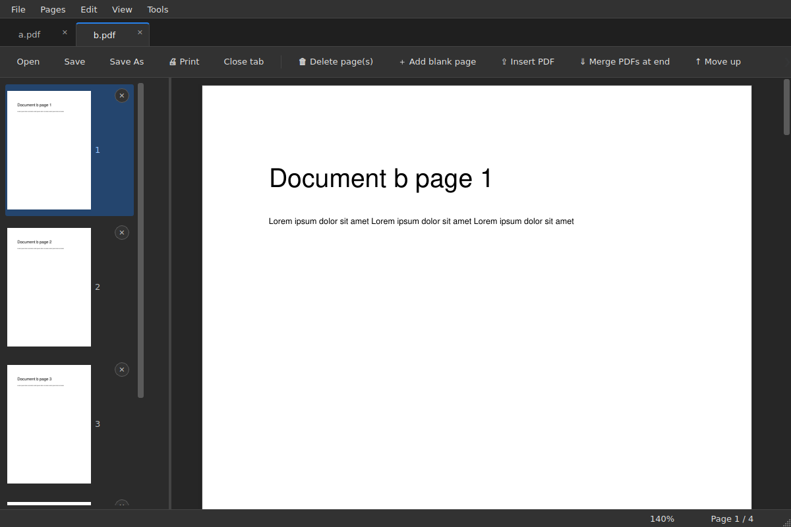
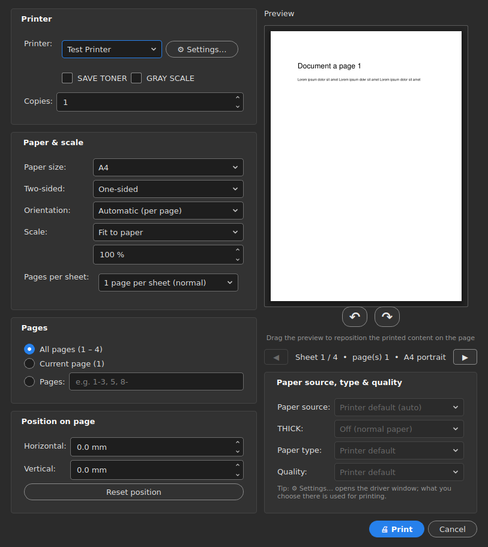

# PDF Studio

A fast PDF reader and editor for Windows, built with PyQt6 and PyMuPDF. It looks and feels like Acrobat (dark grey by default, light with `--light`) and keeps everything in one window.



**Site:** https://vsajjadx.github.io/pdf-studio/

## What it does

- **Tabs, like a browser.** Every PDF you open gets its own tab, in order. Opening another PDF while the app is running adds a tab to the same window.
- **Continuous view.** Scroll through all pages like one document. The status bar shows `Page x / n` and the zoom level. Ctrl + mouse wheel zooms; middle-click starts auto-scroll.
- **Page editing.** Delete, add blank, move, rotate and insert pages from other PDFs, merge PDFs at the end, edit text lines, and undo with Ctrl+Z.
- **Drag pages out.** Drag thumbnails to a folder or the Desktop to export them as separate PDF or JPG files. Drag thumbnails to reorder.
- **Full print dialog.** Printer, A0–A5 and custom paper sizes, orientation, scale, page range, pages per sheet, duplex with flip on the long or short edge, paper source (auto or the bypass tray), paper type, save-toner and grayscale modes, and a live preview you can drag to reposition the content and zoom with the mouse wheel.
- **Explorer integration.** Right-click several PDFs or images to combine them, or a single file to open it directly.



## Run from source

```
pip install -r requirements.txt
python pdf_studio.py [file.pdf ...]
python pdf_studio.py --light        # light theme
```

Add the Explorer right-click menu with `python pdf_studio.py --install` (remove it with `--uninstall`), then pick PDF Studio under Settings → Apps → Default apps if you want it as your default PDF app.

## Download / build the .exe

Every tag that starts with `v` (for example `v1.0.0`) runs the **Build Windows exe** workflow, which packages the app with PyInstaller and attaches `PDFStudio.exe` and `PDFStudio-windows.zip` to a GitHub Release. You can also run the workflow by hand from the Actions tab and download the result as an artifact.

To build locally:

```
pip install -r requirements.txt pyinstaller
pyinstaller --noconfirm --onefile --windowed --noupx --exclude-module pymupdf4llm --exclude-module pymupdf.layout --exclude-module pymupdf_layout --exclude-module onnxruntime --exclude-module numpy --exclude-module networkx --exclude-module yaml --exclude-module psutil --exclude-module tabulate --exclude-module tkinter --exclude-module unittest --exclude-module pydoc --name PDFStudio pdf_studio.py
```

## Requirements

Windows 10 or 11, Python 3.10+ when running from source. The print driver features (paper source, paper type) use the Windows print API; the viewer and editor also start on other systems.

## Persian summary / خلاصه

PDF Studio یک نرم‌افزار سبک برای خواندن و ویرایش PDF در ویندوز است: هر فایل در یک تب جدا باز می‌شود، صفحه‌ها پشت‌سرهم نمایش داده می‌شوند و می‌توانید صفحه‌ها را حذف، اضافه، جابه‌جا، بچرخانید یا PDF دیگری را وارد کنید. پنجرهٔ چاپ کامل آن شامل انتخاب چاپگر، اندازهٔ کاغذ (A0 تا A5 و دلخواه)، دوطرفه، سینی دستی (Bypass)، نوع کاغذ و پیش‌نمایش زنده است. ظاهر برنامه شبیه Acrobat است و به‌صورت پیش‌فرض دارک است.
